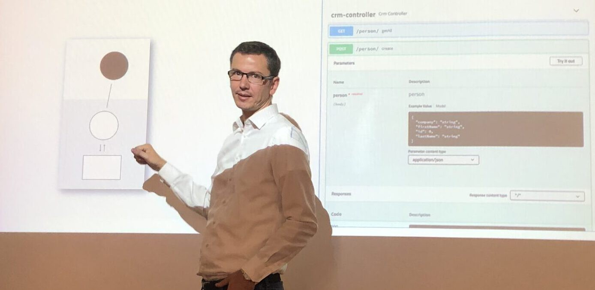

`Testen im Vorgehensmittelpunkt mit BDD`

Am 03.07.2019 darf ich mit meinem Kollegen einen Vortrag über Behaviour Driven Development an der Agile Testing Konferenz die gemeinsam mit der Clean Code Days stattfindet in München halten. Einer der Punkte des Vortrags ist das agile Vorgehen und Testen in den agilen Projekten.

Reicht es nämlich wenn man in einer zentralen Software die Test User Stories in einem Kanban Board verwaltet um das Testen auch agile nennen zu dürfen? Auch wenn im agilen Manifest mit agilen Werten und Prinzipen das Test-Vorgehen nicht explizit erläutert wird, so findet man doch darin Hinweise wie es jedes agile Team zur eigenen agile Testing Lösung kommen sollte.

Als Softwarearchitekt liegt jedoch mein Fokus mehr auf die Architektur der Test Projektes selbst. Fragen wie:

- Wie strukturiere ich meine Test-Module in einem agilen Projekt?
- Mache ich ein monolithischen Test-Projekt oder schneide ich es, und wenn ja, wie?
- Setze ich auf die Wiederverwendung und wenn ja, wobei?

Das ganze gehe ich auf dem Beispiel am Cucumber-Framework für die Java-Programmiersprache an.

Die Seite des Vortrags findet ihr hinter der folgenden Adresse: [https://www.sasec.de/agenda/vortraege/articles/mi52-testen-im-vorgehensmittelpunkt-mit-bdd-sasec.html](https://www.sasec.de/agenda/vortraege/articles/mi52-testen-im-vorgehensmittelpunkt-mit-bdd-sasec.html)

## Nachtrag

Die auf der Agile Async veröffentliche PDF Folien zum Vortrag können hinter dem folgenden Link gefunden werden: [https://www.embedded-testing.de/files/embeddedtesting/site/vortraege2019/tag3/Mi5.2-Hoefling-und-Abdi.pdf](https://www.embedded-testing.de/files/embeddedtesting/site/vortraege2019/tag3/Mi5.2-Hoefling-und-Abdi.pdf)

Vielen Dank für Deine Zeit und liebe Grüße,
[Azmir Abdi](/about-me/)

PS: Ich würde mich über einen Komentar oder eine [Email](mailto:azmir@abdi.info) sehr freuen.

