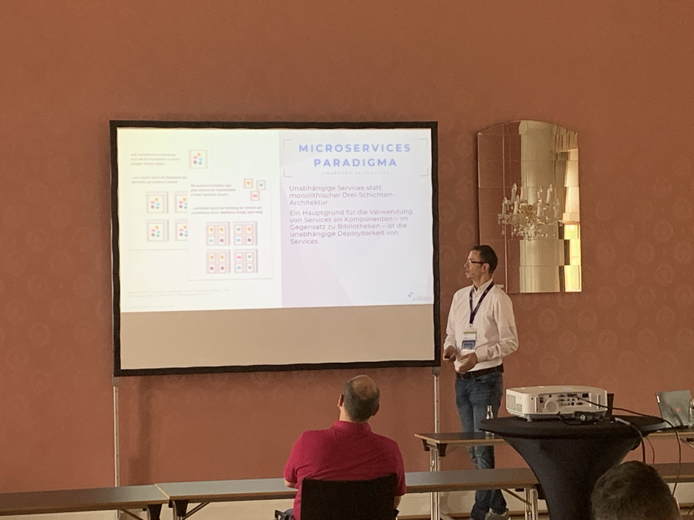
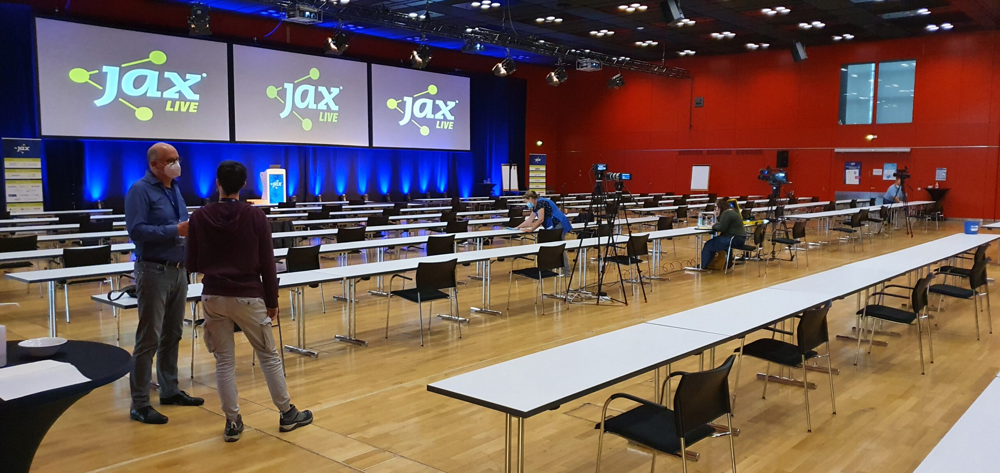
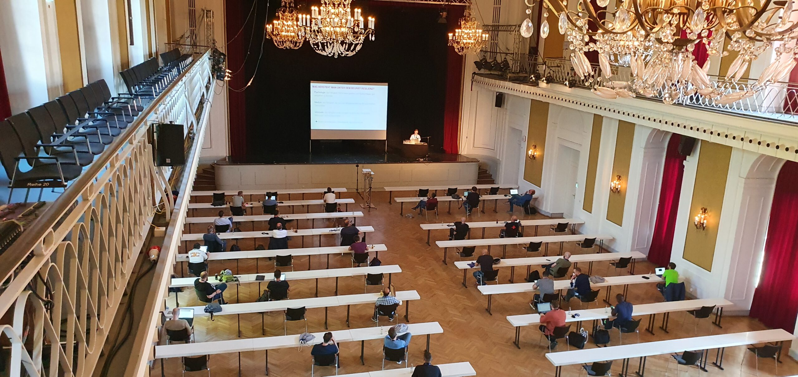
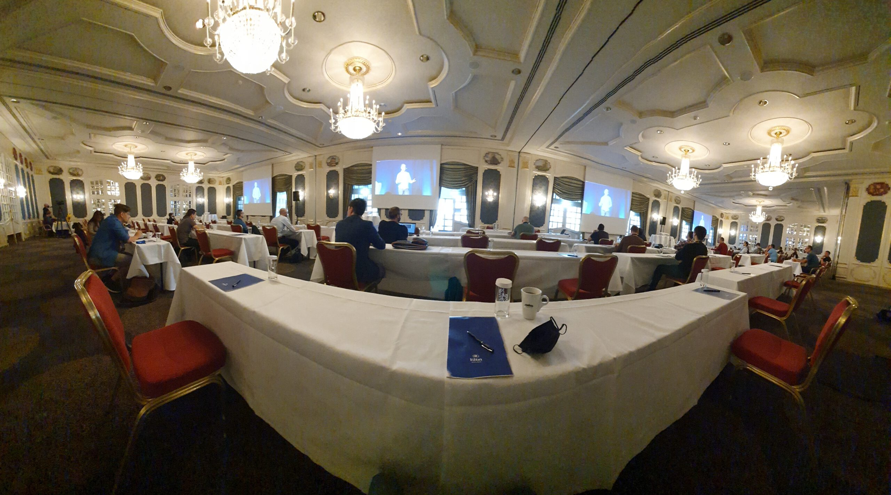
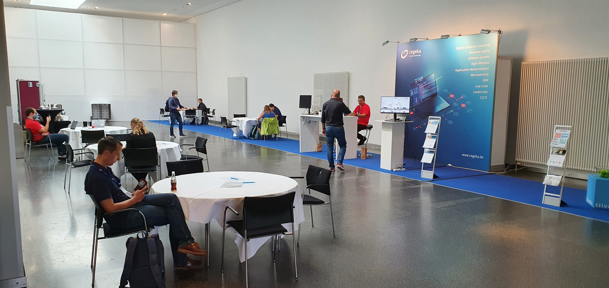
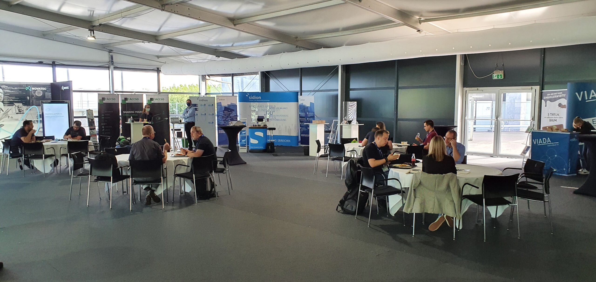

Sehr ungewöhnliche drei Jax [[1]](https://jax.de/mainz/) Tage. Einer Konferenz, auf der es normalerweise von IT-interessierten Teilnehmern nur so wimmelt. Wo das Check-In und die Garderobe gewöhnlich bis zu einer Stunde brauchen können. Dass so eine Veranstaltung auch in der Pandemiezeit stattfinden kann, ist auch ungewöhnlich. Der Veranstalter Software & Support Media GmbH [2] hat einen Strauß an Maßnahmen zusammengestellt, um dies möglich zu machen. Die gesamte Konferenz wurde als Hybrid-Konferenz aufgebaut, mit der Möglichkeit der präsenz- oder online-Teilnahme. Eine professionelle Video-Streaming-Mannschaft, die gewöhnlich (mal wieder gewöhnlich) Großkonzerte begleitet, überträgt alle Sessions, die parallel in acht unterschiedlichen Räumen verteilt an drei Locations gleichzeitig stattfinden. Über die online Plattform SwapCard [3] begleiten die online-Teilnehmer die Sessions als Stream und können per Chat an der Diskussionen teilnehmen. Die Präsenzteilnehmer bleiben jeweils für einen Vor- oder Nachmittag in derselben Gruppe in einem Raum. Gesichtsmasken, Abstand und Hygiene, wie aktuell üblich, sind bei der Bewegung durch die Räumlichkeiten vorgeschrieben.

Ich durfte gleich zwei Talks an der Konferenz jeweils mit einem Kollegen/ einer Kollegin halten. Im ersten Talk ging es um die Integrationstests in einer komplexen Microservices Umgebung [[4]](https://jax.de/software-architecture/architektur-der-integrationstests-in-der-aera-der-microservices/). In dem zweiten Talk um die übergreifenden Geschäftsprozesse, ebenfalls in einer komplexen Microservices Umgebung [[5]](https://jax.de/microservices/microservices-und-bpm-liebe-it-denkst-du-noch-an-das-geschaeft/). Insgesamt beschäftige ich mich mit dem Microservices Paradigma als IT Architektur und dem damit verbundenen agilen Vorgehen schon länger. Dieses hat wiederum Folgen für alle IT-Bereiche wie auch für die übergreifenden Geschäftsprozesse und die damit verbundenen Integrations- oder *End-To-End* Tests. Die Vorträge liefern Ansätze, wie diese Bereiche auch agil abgedeckt werden könnten.

Es war neu für mich, als Speaker nicht nur die vor Ort anwesenden Teilnehmer im Blick zu behalten, sondern eben auch die über die online-Plattform angemeldeten Teilnehmer und die zugehörige online-Diskussionen. Andere Speaker wiederum waren selbst remote und hatten einen direkten Einblick nur auf die online Plattform. Aus den Räumlichkeiten wurden sie von Vor-Ort-Moderatoren unterstützt und konnten hier über Zoom in Video-Austausch mit den Moderatoren ein paar Vor-Ort Eindrücke sammeln.

Insgesamt verlief diese Hybrid-Konferenz für das erste Mal mit überraschend wenig technischen Pannen. Hierfür ein Lob an den Veranstalter. Es steht fest, dass Hybrid-Konferenzen und auch Hybrid-Workshops zwischen Präsenz- und Remote-Teilnehmern in der heutigen Zeit eine Lösung sind und damit auch benötigt werden. Wir alle und die Technik/Tools müssen in dieser Art der Zusammenarbeit noch besser werden, was sicherlich mit der Zeit auch geschehen wird. Ich bin gespannt über die Art und Weise, wie wir letztendlich damit in ein paar Jahren umgehen werden.

Vielen Dank für Deine Zeit und liebe Grüße,
[Azmir Abdi](/about-me/)

PS: Ich würde mich über einen Kommentar oder eine [Email](mailto:azmir@abdi.info) sehr freuen.

- 
- 
- 
- 
- 
- 
