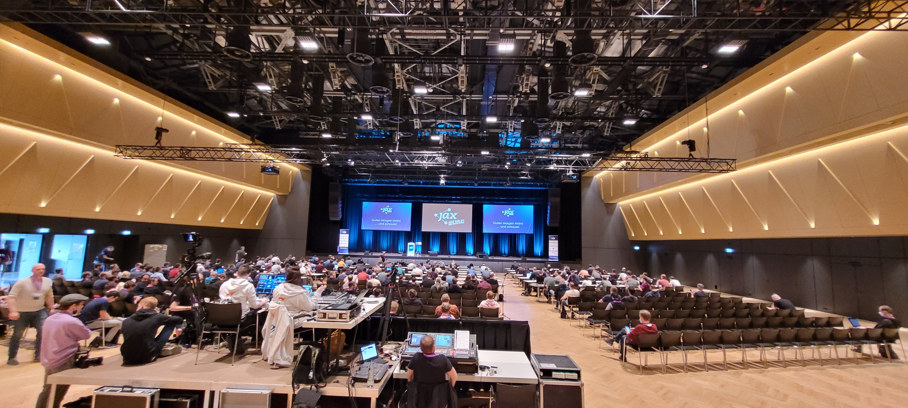
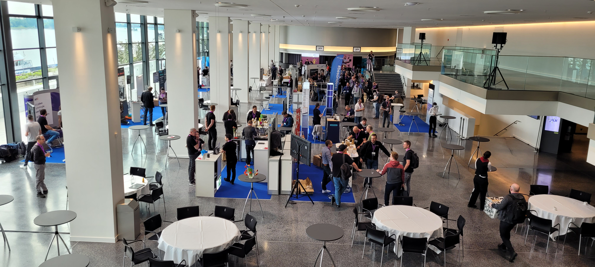
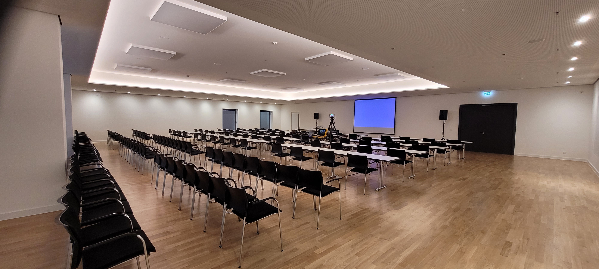
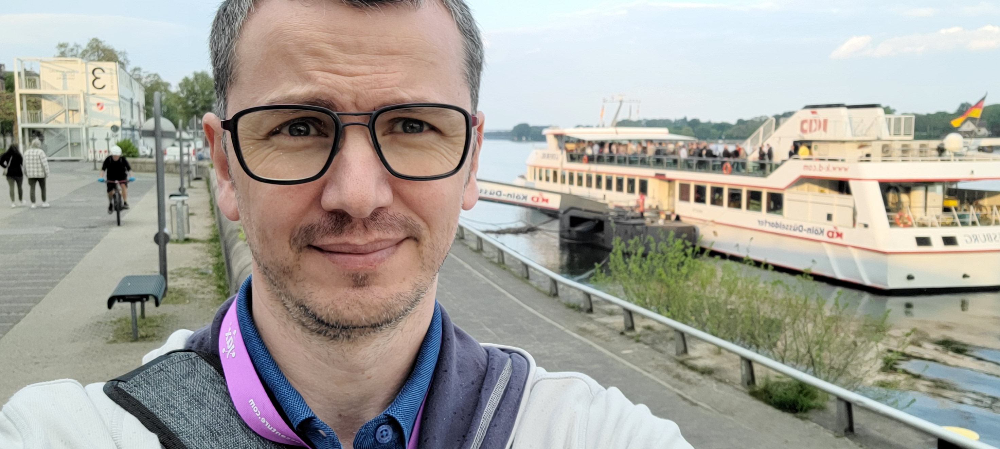

[JAX2022](https://jax.de/mainz/programm-mainz/) wieder live vor Ort in Mainz – ein kleines Stück alter Normalität in der neuen Wirklichkeit. Es tut auf jeden Fall gut sich wieder direkt mit begeisterten IT-lern zu den neuen spannenden Themen auszutauschen. Themen wie #Kubernetes, #Serverless, #DDD, #jMolecules, #Quarkus, #Knative, #WebAssembly, #MutationTesting etc … Von dem Big-Picture Überflug bis zum Deep-Dive Live Coding – es ist sehr viel dabei für die IT-Seele.

Ich selbst dürfte auch ein Vortrag mit meinen Kollegen @Winfried Bittner halten zum Thema „**Event-Driven Microservices-Tests“**[https://jax.de/devops-continuous-delivery/event-driven-microservices-tests-wie-die-cd-pipeline-mit-cdc-und-bdd-die-e2e-tests-abloest/](https://jax.de/devops-continuous-delivery/event-driven-microservices-tests-wie-die-cd-pipeline-mit-cdc-und-bdd-die-e2e-tests-abloest/)

Alles rund um das Thema #ContinuousDelivery stößt auf immer mehr Interesse. Unser IT-Alltag wird immer volatiler. Der Vortrag gibt ein paar Hilfestellungen zur Einordnung der Testing-Strategien in dem agilen Umfeld ein.

Vielen Dank an den Speakern, Veranstalter Sandsmedia GmbH und an die Kollegen (sidion Gmbh) für die Organisation.

Vielen Dank für Deine Zeit und liebe Grüße,
[Azmir Abdi](/about-me/)

PS: Ich freue mich über eine [Nachricht](/about-me/#kontakt).

- 
- 
- 
- 
