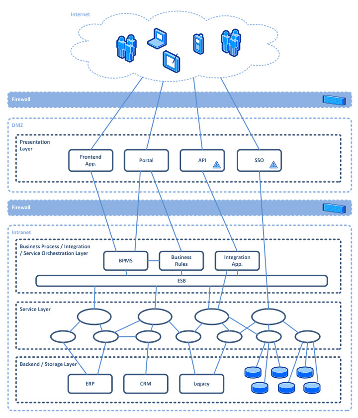
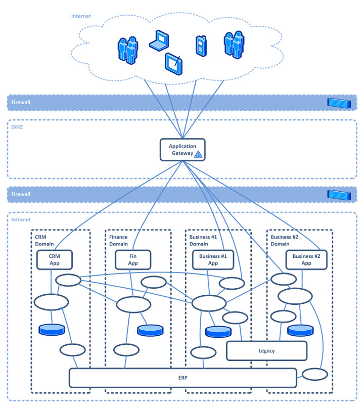
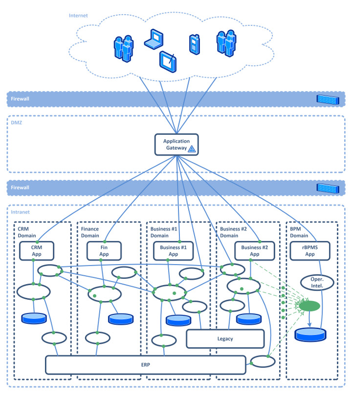

#### Does classical business process management (BPM) contradict an IT architecture built on the microservice approach? A correct microservice approach allows no central, enterprise-wide process-control component. This article describes what a correct implementation of BPM systems along the microservice approach would have to look like, and analyses the effects of that fusion of opposites.

What do BPM, SOA, and microservices stand for in the first place? To build an understanding of the elementary properties of the different approaches to process optimisation, the first part of the article goes into the terms BPM, SOA, and microservices, the motivation of each, and the differences between SOA and microservices. The second part presents BPM applied to the microservice approach, slightly adapted, as rBPM (reverse BPM).

## BPM, SOA, and microservices

Business process management (BPM) is a comprehensive approach to organising a company, concentrated on continuous optimisation and thus on maximising the profit of the core business. The core business is fitted into end-to-end business processes that cover the organisation’s own work from the customer order to the final delivery to the customer. The IT-supported solution for BPM is the BPM system (BPMS), in which the end-to-end business processes are steered automatically by integrated, central business process engines (BPE).

The BPM approach plays excellently with the service-oriented architecture (SOA) as enterprise SOA, as [Dirk Slama’s article](https://www.computerwoche.de/a/soa-und-bpm-wachsen-zusammen) already described more than ten years ago. By now we know that SOA in its original form is already outdated. The microservice approach, described decisively by Martin Fowler, is the [next evolutionary step of enterprise architecture](https://martinfowler.com/articles/microservices.html).

## Are microservices not SOA?

SOA, just like microservices, is an answer to the poor maintainability of complex monolithic IT. In SOA, mastering complexity through structure is in the foreground. Also in focus is the optimisation of IT by eliminating the waste of solving the same problem several times, through reuse. Every problem is to be solved once, across the enterprise. The solution is published internally, and care is taken that it is reused.

> ***SOA setzt au***f Wiederverwendung.

The line above is kept in German on purpose. In the original markup the emphasis breaks inside the word “auf”. Read as a sentence, it says: SOA relies on reuse.

The reuse of services that use a central domain model is decisive in SOA. The enterprise service bus (ESB), as a central intelligent integration component, connects the services. The whole enterprise architecture is organised in layers, as **Figure 1** shows by way of example.

Fig. 1: Service-oriented architecture (SOA)

As an addition, a BPMS partly takes over the service orchestration that usually happens through the ESB. BPM can therefore be applied to SOA natively. The differences between how SOA came to be understood and the microservice approach are significant. Matt McLarty has described the distinction between microservices and SOA in a very readable [article](https://www.infoworld.com/article/3080611/application-development/learning-from-soa-5-lessons-for-the-microservices-era.html).

One of the contradictions between SOA and BPM and the microservice approach sits exactly at the ESB. The microservice approach relies on lightweight integration. With the principle “smart endpoints and dumb pipes”, the decoupling of systems that was praised in SOA is finally supposed to become real, instead of monolithic EAI of the kind the ESB applies in SOA. Conway’s law, which the microservice approach orients itself by, speaks for this as well. According to [Conway](http://www.melconway.com/Home/Conways_Law.html), IT systems are inevitably organised along the communication structures of the organisation.

An organisation structured according to SOA has units positioned inside the horizontal SOA layers. Because in SOA a professional domain stretches vertically, from the surface down into persistence, through all layers, it is also distributed across several organisational units. For a change that has to be implemented in that domain, several organisational units have to coordinate. The result is the need for centrally coordinated releases in order to get that change out.

With the principle “organized around business capabilities”, Martin Fowler applies Conway’s law to the microservice approach. An organisation should be structured along its professional domains, and so should the IT, with the aim that a change to one domain can be carried out inside one organisational unit. Slow coordination and complex releases are to be eliminated as waste. The microservice approach (**Fig. 2**) is the answer to the non-functional requirement to implement changes quickly. Back to the ESB in SOA. How often does an organisation have a unit that can be represented in IT by the ESB?

Only curious examples come to mind: a team with file trolleys, equipped with a mobile workplace, translating the files on the way into the target format for the next department (transformation and mapping).

Fig. 2: Enterprise architecture according to the microservice approach

> SOA means central planning and control

Both SOA and BPM assume central planning and control. Now, what could be wrong with planning and steering a company centrally? After all, every company has management precisely for this, and management plans and steers centrally. Is that so? Do managers steer the implementation directly, without the levels in between? Or is it rather that, in successful companies, management sets the guard rails by means of the vision and the mission? Company goals follow from that. Usually the goals, and with them the plans, are broken down onto professional units. The teams in those units work out detailed plans for themselves and are themselves responsible for the implementation. There is no central master plan worked out down to the last detail.

Successful companies show it: agile teams try to reach their own derived goals, through their own planning and with an integrated effort to improve (such as the sprint retrospective in Scrum), as well as they can. Management contents itself with regular reports of the results from the teams and regularly checks whether the company, in the overall view (the big picture), is still on the right course. In enterprise SOA, though, it is exactly this central master plan that is built, steered, and controlled through the central control of processes by BPM.

Through SOA governance, a committee controls IT changes and makes sure they are coordinated centrally. The central domain model, system integration, and the choice of technology are strongly regulated. This confirms Conway’s law once more. The artificial structures created by IT have to be maintained at high cost. Otherwise they would be bypassed. As evidence, look in SOA for direct interfaces between front-end and back-end systems.

Looked at the other way round, one could say that SOA and BPM are in the right place in organisations where every step has to be carried out exactly according to a central plan, where unchecked attempts at optimisation are not allowed, for example in the heavily regulated pharmaceutical industry. Most other organisations want to become more agile and profit from the experience of their own employees. For IT that means allowing more agility, allowing changes faster, aligning IT to change. Not a central monolithic IT, but small applications separated by domain, which fit the implementation teams exactly and which are also able, in today’s world of agility, to keep pace.

This article does not want to deal with how that agile architecture can be reached. There are already publications for that, for example the books by Eberhard Wolff [1] or Matt McLarty [2], and also the [articles on self-contained systems](http://scs-architecture.org), which describe a concrete implementation of the microservice approach. This article is primarily about BPM, with the interesting question: where does BPM remain in this new agile world of microservices?

> BPM should orient itself by Conway as well

BPM says that the end-to-end processes in an organisation should be analysed, recorded, steered, monitored, and optimised. Organisations that implement this in an IT-driven way are certified according to ISO 9001 or at the highest level of CMMI. How the implementation should look is up to the organisation. Even so, [BPM teaching](https://www.computerwoche.de/a/soa-und-bpm-wachsen-zusammen) says that process control should come from a BPM system. This demand of BPM for central control should give way to the demand for a central, automated evaluation of processes.

It is enough for management to have the results reported at regular intervals. BPM should not prescribe how the digitalisation of processes is implemented, just as the central planning of a planned economy pursues noble goals but cannot, in the implementation, keep up with a free market economy. The IT structures in large companies have to become freer as well.

For BPM that means there should be no central control component for the end-to-end processes, and no detailed central plan either. BPM can help when process transparency suffers because of complexity and the size of the organisation. BPM should make the processes visible and uncover potential for optimisation in the sense of the company’s goals.

## Reverse BPM (rBPM)

The BPM titled here as reverse BPM (rBPM) tries to keep the properties of the microservice approach described above. rBPM still pursues the same goals as BPM, in that the organisation’s processes are analysed, recorded, steered, monitored, and optimised. The difference lies in process control. As the name reverse BPM says, the idea of reverse engineering is applied: the process flows are reconstructed by means of [operational intelligence](https://en.wikipedia.org/wiki/Operational_intelligence).

### Process analysis, recording, and monitoring

With operational intelligence (OI), process transparency is reached by collecting the data from processing (operations) and interpreting it into information (intelligence). The procedure is comparable to business intelligence (BI), but it differs in the speed at which the information is provided. In contrast to BI, where information in the form of reports is delivered at the earliest on the following day, and usually after the monthly, quarterly, or yearly close, OI makes it possible to gain information about business processes almost in real time.

The method is also known under the name business activity monitoring ([BAM](https://en.wikipedia.org/wiki/Business_activity_monitoring)). The operational IT systems should report professional events to OI, and not once, but constantly, for every process instance. For which process is what being done right now, and for which process instance, in which version? A reverse BPM system (rBPMS) should continuously evaluate these explicitly collected OI process data, analogously to BAM. The system should also be able to reconstruct a process flow completely and to display it according to Business Process Model and Notation (BPMN).

Under the condition that all professional process steps are reported to OI, process analysis and recording can thus be partly automated. The recorded flows would in every case always depict the actual state. Newly recorded, still unknown flows could be reported to the process owner for review.

### Process control and execution

In rBPM, service tasks and human tasks are implemented by microservices according to the teams’ own specifications. If the microservice itself has to manage its own internal status over long-running processes, nothing speaks against using an embedded business process engine, such as the [Camunda BPMN Engine](https://camunda.com/products/bpmn-engine/). The process owner can record the target process definition in the rBPM system for comparisons of target and actual. Development and test can use these comparisons as acceptance criteria.

The alignment of actual and target should happen in the development and test environment until they match. On the production environment there should then be no larger surprises. The difference is that, in rBPM, the BPM system continuously analyses the processes after the fact and, where possible, compares them with a target or plan model. BPM does not lead the process control.

The professional applications involved are solely responsible for that. rBPM steers the process flow only indirectly, by reporting unexpected or unknown changes to the process owner through process transparency. He could acknowledge them or have them corrected through a change request (CR). That ensures that, even in rBPM, the processes are steered by the assigned process owner, and thus by BPM. This happens purely organisationally, and yet it is managed by an IT system.

### Process optimisation

In classical BPM the process owner creates a target process model, which becomes the actual model by being recorded in the BPMS. The BPMS steers the execution of process instances according to the actual model. BPM process optimisation in rBPM happens by the process owner, as part of BPM, reacting to the real-time process analysis and raising a CR when a change is needed. The process owner raises the CRs for the respective target-process segments of the microservice domains they belong to. The microservice teams implement the CRs according to their own judgement.

### rBPM architecture

End-to-end business processes pass operationally through several professional domains in the organisation. According to Martin Fowler, these should not be implemented in a single operational system, but split per domain across several systems. So that the systems can reach their own decoupling, the main goal of the microservice approach, they should implement the control and the execution of the tasks they are responsible for themselves.

For the IT architecture that would mean that the implementation of the individual process steps and tasks in microservices can be left freely to each product owner and their team, just as Martin Fowler recommends: no technology prescriptions from business process management, free implementation of optimisations, and free development. In order to reconstruct the process flow of the end-to-end business processes completely, the operational intelligence of the rBPMS must receive all the data necessary for that.

So that the operational systems keep their decoupling, this should happen asynchronously (**Fig. 3**). The BPMN standard could be extended with these asynchronous process events as well. All possible BPMN events that should be reported as events could be standardised. Both individual software makers and standard-software vendors could then build rBPM systems that provide all the BPM requirements that are needed. rBPM systems already in use could become replaceable through standardisation.

Fig. 3: BPM as reverse BPM (rBPM) according to the microservice approach

## Conclusion

Further advantages of a BPM system implemented according to rBPM can be listed, in addition to architectural compatibility with the microservice approach. First, the simple, non-invasive introduction into the existing IT landscape speaks for it. Because an rBPMS does not steer process execution directly, that execution would not have to be lifted out of the existing operational systems and migrated to a BPMS.

An rBPMS would have to act as an IT application of its own supporting cross-cutting domain, decoupled from the operational domains. That creates no loss of performance, because the operational systems can send the events asynchronously. Like the microservice approach itself, rBPM lacks, in contrast to classical BPM, elegance and ease of handling, as all decentralised approaches do in contrast to central ones. The finely structured overall architecture of IT in SOA is to be replaced by a microservice architecture that looks wild at first glance.

Furthermore, there would no longer be an enterprise-wide central task list, provided by the BPMS, for the execution of human tasks. Providing that in addition would also speak against the microservice approach, because it would again intervene operationally in several professional domains. Process transparency in rBPM would be gained only if the process information is also collected. The danger that important professional steps are not reported by the operational systems would always be there.

In testing, automated execution of the tests would not be possible without extensions. As in classical BPM, the evaluation of the test results of the end-to-end processes in a test environment could be implemented inside the rBPMS in reverse BPM. Executing the start events and the human tasks for tests would have to happen separately. In the end, with rBPM one could still introduce a comprehensive business process management, with all its advantages, into the new agile IT of microservices.

## Links and literature

[1] Wolff, Eberhard: “Microservices”, dpunkt.verlag, 2015
[2] Amundsen, Mike; McLarty, Matt; Mitra, Ronnie; Nadareishvili, Irakli: “Microservice Architecture”, O’Reilly, 2016

Thanks for your time. Warm regards,
[Azmir Abdi](/en/about/)

PS: A comment or an [email](mailto:azmir@abdi.info) would make me glad.
