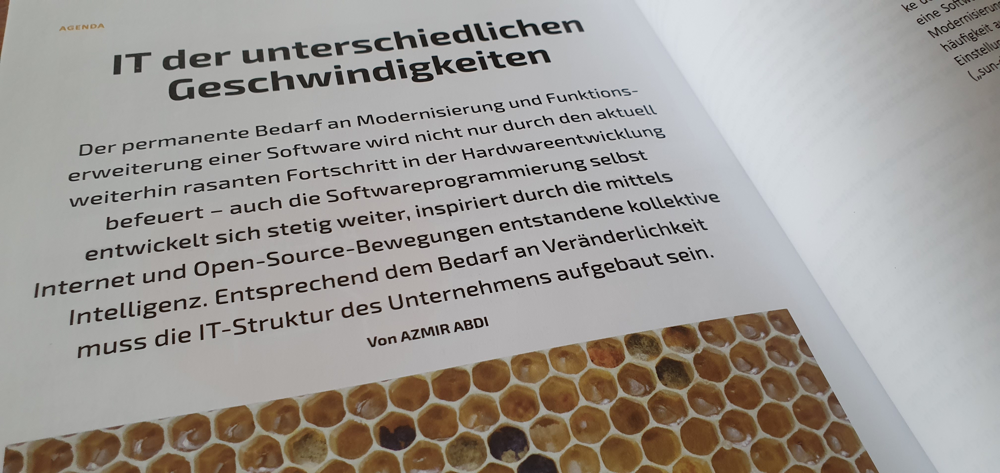
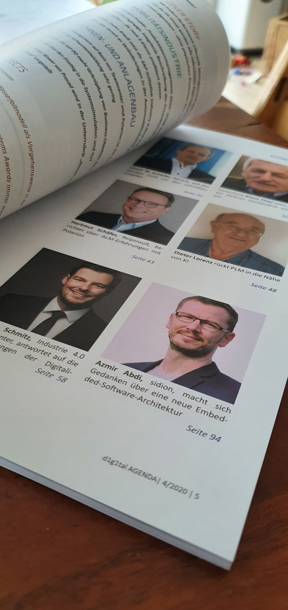
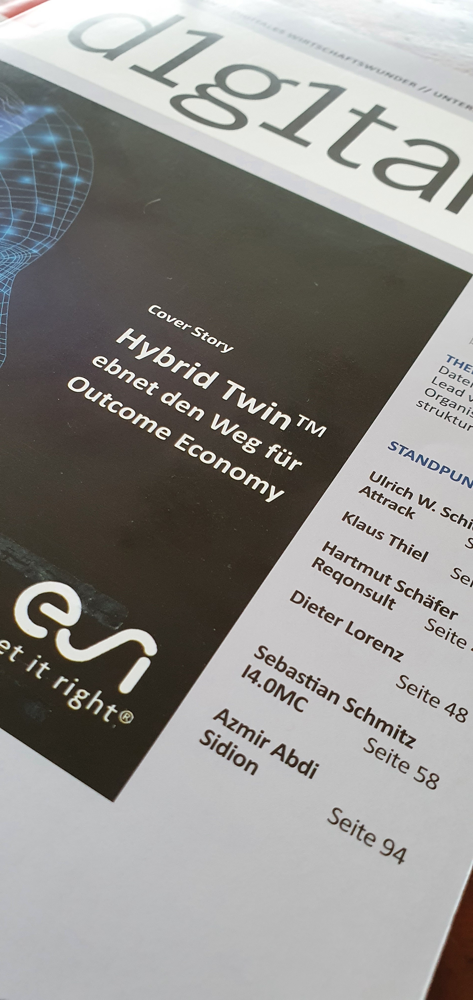

> The permanent need to modernise software and extend what it does is not fed only by the still rapid progress of hardware. Programming itself keeps developing, inspired by the collective intelligence that came with the internet and the open-source movement. The IT structure of an organisation has to be built for that need to change.
>
> — Azmir Abdi, translated from the German text in [d1g1tal Agenda 2020/04](https://d1g1tal.de/neu-ausgabe-04-2020-der-d1g1tal-agenda/). This is not a verified English original.

Two years ago now, an article of mine appeared in d1g1tal AGENDA Magazine. The subject: speed. A plea for levelling the pace of software development. Look at the product, not the project. That matters even more for the applications that carry an organisation’s core business and core processes, because that is where speed is required. You do not get it by having software built expensively in a project and then letting maintenance pinch it down to a low flame. Instead of a lot at the start and too little afterwards, development should be levelled. Only then can an agile approach reach its highest speed in adapting to the market.

[Link to the issue](https://d1g1tal.de/neu-ausgabe-04-2020-der-d1g1tal-agenda/)

